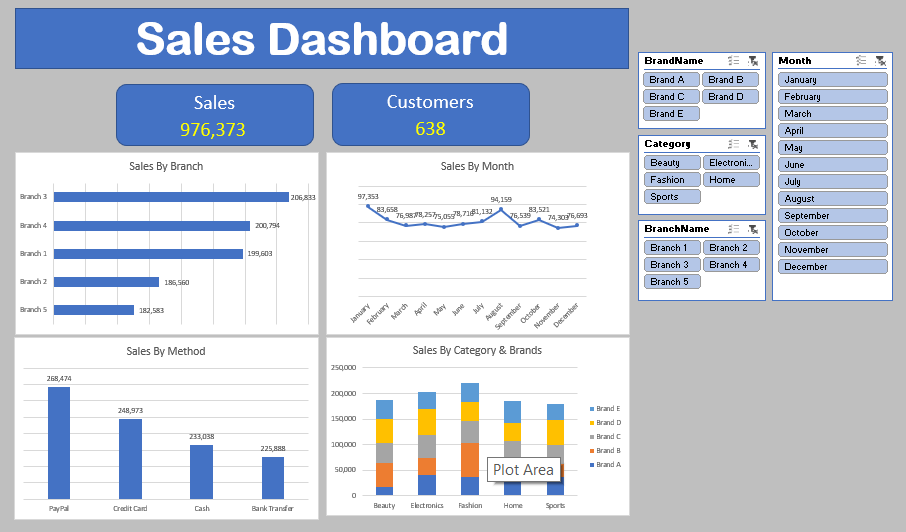

# 🛍️ Retail Performance Analytics Dashboard

A comprehensive sales performance analysis project. This dashboard visualizes key metrics across brands, product categories, and regional branches, providing actionable insights into revenue trends and payment method efficiency.

## 📊 Dashboard Preview

## 📌 Project Overview
- **Objective:** Analyze retail and sales performance to track revenue streams, evaluate brand success, and optimize regional branch efficiency.
- **Tools Used:** Excel, Advanced Dashboards, Pivot Tables.
- **Key Metrics Tracked:**
  - Total Revenue & Sales Trends
  - Brand & Product Category Performance
  - Regional Branch Comparison
  - Payment Method Efficiency

## 📂 Files in this Repository
- `Project Excel 1.xlsx`: The raw dataset and interactive Excel dashboard file.
- `Retail-Dashboard.png`: Visual preview of the retail analytics dashboard.
